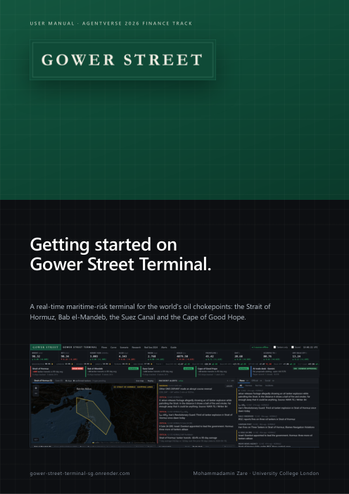

<p align="center">
  
</p>

<h1 align="center">Gower Street Terminal</h1>

<p align="center">
  <b>Live: <a href="https://gower-street-terminal-sg.onrender.com">gower-street-terminal-sg.onrender.com</a></b><br>
  <i>Free hosting, so the first load after a quiet spell can take up to a minute.</i>
</p>

A real-time maritime-risk terminal for the world's oil chokepoints: the **Strait of Hormuz**, **Bab el-Mandeb**, the **Suez Canal** and the **Cape of Good Hope**. It brings together live shipping data, verified news and official statements, energy prices, and an AI trading agent whose every proposal is computed, risk-checked and audited in code, and approved by a human.

Built by **Mohammadamin Zare** at University College London. The idea came from a simple question: when a tanker is hit in the Persian Gulf, what should a trader actually do, and how would they know whether they were right?

## Demo

<p align="center">
  <a href="docs/gower-street-promo.mp4">
    
  </a><br>
  <b><a href="docs/gower-street-promo.mp4">▶ Watch in full HD (35 s)</a></b>
</p>

## User manual

<a href="docs/Gower-Street-Terminal-Manual.pdf"></a>

**[Getting started on Gower Street Terminal](docs/Gower-Street-Terminal-Manual.pdf)** (PDF, 16 pages) walks through every part of the screen: the risk banner, ship maps, incident alerts, the AI trade desk and its risk limits, the news and official feeds, each tool, a quick reference and the evidence.

It can also be downloaded inside the terminal from the **Manual** button in the top menu.

<br clear="right">

---

## What it does

| | |
|---|---|
| **Ships** | Live AIS positions in four chokepoints, with tankers highlighted, 24-hour replay, transit counts and a VesselFinder view for areas the free feed cannot see |
| **Incidents** | Automatic alerts for distress signals, sudden stops in the lane, ships going dark, GPS jamming, OFAC-sanctioned vessels and suspected ship-to-ship transfers |
| **Information** | Credited news from named outlets; official statements from the US, Iran, Israel, the Houthis, the Persian Gulf states, the UK and the UN, each labelled by side; social posts marked unverified |
| **Markets** | Brent, WTI, products, gas, gold and tanker equities; futures curve and spreads; IMF PortWatch transit data; a disruption scenario calculator |
| **AI analyst** | A sourced risk brief every hour and after critical alerts, plus a chat that answers from the live data |
| **Trade desk** | An agent proposes paper trades; code prices them, checks them against hard limits and logs every step; a human approves or rejects |

## The trade desk

The model contributes judgement only: direction, probability, horizon and the evidence behind it. Everything else is deterministic:

- **Base rates** are looked up from an event study of 20 Persian Gulf and Red Sea incidents since 2019, not written by the model.
- **Levels, costs and expected value** are computed in code, and the formula is shown for every trade.
- **Risk limits** are enforced in code: at most 1% of book per trade and 3% in total, one position per instrument, positive expected value after costs, and a cap on how far the model's confidence may exceed history.
- **Human approval** is required for every trade. A kill switch halts or flattens the book, and every action by the agent, the server or a person is written to an audit log.
- **Decision traces** link each trade back to the exact data the agent saw.

Paper trading only: no code path can place an order.

### Risk controls and data

| | |
|---|---|
| **The agent may do alone** | Read the live data, write the brief, answer questions, and *propose* paper trades. |
| **Code enforces, whatever the agent says** | Prices, costs, expected value and every risk limit: 1% of book per trade, 3% open, 2% per risk group, one position per instrument, positive EV after costs, confidence capped at 25 points over the historical base rate, stops outside normal noise. A trade that fails any check is blocked. |
| **Needs a human** | Opening every trade (Approve / Reject), closing it, and the kill switch (halt, or halt and flatten). Unapproved proposals lapse after 60 minutes, and approval is refused if the price has drifted. Every action by the agent, the server or a person is in the audit log, and each trade links to the exact inputs the agent saw. |
| **Where each model runs** | Anthropic Claude (Haiku 5.5 on the public site; set by `ANALYST_MODEL`) runs in Anthropic's cloud, called through the Claude API from the terminal's server (Render, Singapore). No model runs in the visitor's browser. |
| **What user data leaves the device** | No accounts, no cookies, no personal data collected. Questions typed into Ask go to the server and on to the Claude API to be answered. The server sees visitors' IP addresses only to apply rate limits, and records approvals under a short one-way hash of the IP, never the address itself. Display preferences stay in the browser's local storage. |

Benchmarks are declared up front: cash, buy-and-hold over the same window, and a naive "buy the headline" rule, all after the same trading costs.

## Evidence

All results are after trading costs and measured out of sample, where each call may only use earlier incidents. Samples are small and the figures are stated as such.

| Test | Result |
|---|---|
| Next-day Brent direction after an incident | 5 of 14 correct (p = 0.91): no edge |
| Fading escalation over 20 trading days | 9 of 14 correct; +1.3% per incident against −2.6% for buy-and-hold (90% CI of the edge: +0.5% to +7.5%) |
| The AI desk itself (Claude Haiku), given only what was known each day | Traded 4 of the 20 incidents, 1 trade profitable, −0.67% of book in total (90% CI per incident −0.09% to +0.02%): a small loss and no evidence of skill. The risk checks blocked 4 further ideas |

The last result is why the desk is built around human approval and hard limits rather than autonomy: the model adds judgement, not a proven edge. The **Research** window in the app shows the full study, and **Red Sea 2024** replays the 2023–24 crisis day by day.

Reproduce with `node scripts/build-research.mjs` and `node scripts/agent-backtest.mjs`.

### Sealed hidden test (Agentverse finance kit)

The kit's `real-markets` challenge supplies prices only, with no news, so it cannot exercise the news-driven agent. It does test the desk's deterministic risk layer, packaged as a long-only, price-only strategy in [`src/strategy.js`](src/strategy.js): volatility-scaled trailing stops, entry only when the expected move clears costs, exit when the trend breaks. The kit generated 60 windows of real Binance Vision prices in memory after the code was fixed, committed to its seed before the run and revealed it afterwards. Orders fill at the next bar, with fees and slippage.

| Result (60 hidden real-price paths) | |
|---|---|
| Wins / losses against buy-and-hold | 32 / 28 (sign test p = 0.70) |
| Median excess over buy-and-hold | +0.56% of capital |
| Beat holding cash | 17 of 60 |
| Mean maximum drawdown | 6.5% |
| Verdict | Not distinguishable from buy-and-hold |

Full report, seed commitment and reveal: [`evidence/agentverse-challenge-real-markets-60`](evidence/agentverse-challenge-real-markets-60/REPORT.md). The adapter's SHA-256 recorded by the kit (`5f08ea2c…bdc07`) matches [`scripts/agentverse-adapter.mjs`](scripts/agentverse-adapter.mjs). To rerun, with the kit's `finance` folder:

```bash
python bench.py challenge --pack real-markets --cases 60 --project <repo> --output <new-dir> --adapter node <repo>/scripts/agentverse-adapter.mjs
```

## Running it

Requires Node.js 22 or later.

```bash
npm install
```

```bash
npm start
```

Open http://localhost:8787. `npm run demo` runs with clearly labelled simulated ships instead of live AIS.

Copy `.env.example` to `.env` to add keys. All are optional; any panel without its key says so instead of showing invented data.

| Key | Enables |
|---|---|
| `AISSTREAM_API_KEY` | Live ship positions (free at aisstream.io) |
| `ANTHROPIC_API_KEY` | AI analyst, chat and trade desk (Anthropic Claude; `ANALYST_MODEL` picks the model) |
| `NTFY_TOPIC` or `TELEGRAM_BOT_TOKEN` + `TELEGRAM_CHAT_ID` | Phone alerts |
| `X_BEARER_TOKEN`, `BSKY_HANDLE` / `BSKY_APP_PASSWORD`, `TELEGRAM_CHANNELS` | Social sources |

`render.yaml` deploys it to Render's free plan; a `Dockerfile` is included for other hosts.

## Data sources

Yahoo Finance and CNBC (delayed prices) · Binance Vision (CC BY-NC-SA 4.0; real-price windows in the kit's hidden test, not endorsed by Binance) · IMF PortWatch (chokepoint transits) · aisstream.io (AIS) · US Treasury OFAC SDN list (sanctions) · named news outlets, Google News and Reddit (headlines, credited) · VesselFinder (embedded map) · Esri and OpenSeaMap (map tiles) · Anthropic Claude (analysis). Each is used under its provider's terms; see [NOTICE.md](NOTICE.md).

## Limitations

- Free AIS relies on shore receivers and has little coverage inside the straits; ships also go dark or spoof positions deliberately.
- Prices are delayed. Detections are heuristics to investigate, not confirmed events.
- The historical samples are small, and the model may know how past events ended, so the live paper record is the only fully unseen test.
- Nothing here is investment advice.

## Credits

- **Anthropic Claude** (via the Claude API) powers the live AI analyst, chat and trade-desk proposals, and the agent backtest.

## Licence

© 2026 Mohammadamin Zare, University College London. All rights reserved. See [LICENSE](LICENSE).
